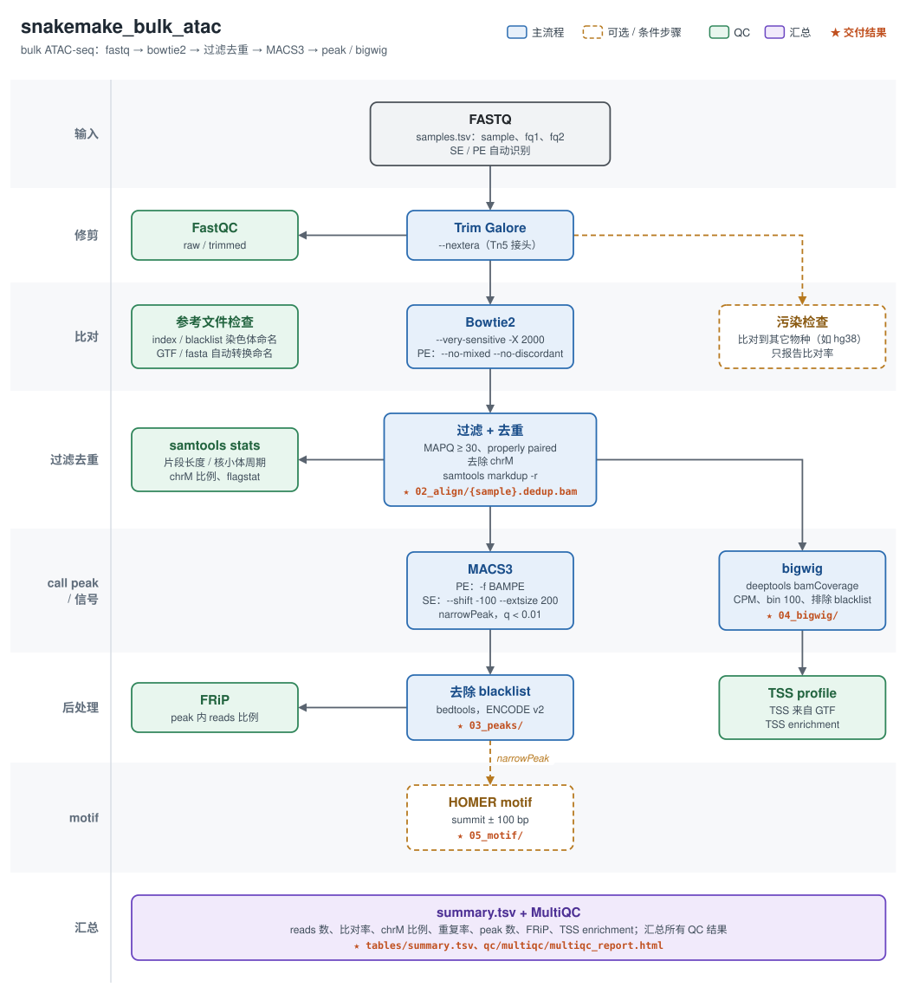

# snakemake_bulk_atac

[中文](README.md) | **English**

Local bulk ATAC-seq pipeline (Snakemake ≥ 9.12). For ChIP-seq / CUT&Tag use `pipeline/snakemake_bulk_chip`.



<sub>Solid boxes are the main workflow, dashed boxes are optional or per-sample conditional steps, green boxes are QC, and ★ marks deliverables (paths relative to `results/`). The diagram labels are in Chinese. PNG version: `docs/images/bulk_atac_workflow.png`.</sub>

<details>
<summary>Text version</summary>

```
fastq ─► trim_galore --nextera ─► bowtie2 ─► filtering (MAPQ≥30, properly paired, chrM removed) ─► dedup ─► macs3 ─► blacklist removal ─► FRiP
             └─ FastQC (raw / trimmed)                                          ├─► bigwig ─► TSS profile / enrichment
                                                                                ├─► samtools stats (fragment length, nucleosome pattern)
                                                                                └─► HOMER motif (optional)
                                     Optional: contamination check (alignment to another species)
                                     Replicates: peak reproducibility, consensus-peak correlation and PCA, sex (fraction of reads on chrX / chrY)
                                     Summary: summary.tsv + QC report + MultiQC
```

</details>

---

## Quick start

```bash
P=/home/LAB/lab_ab_1/pipeline/snakemake_bulk_atac
cd /path/to/project

# 1. Create a project config template (generated when the -c file does not exist); edit genome, etc.
bash $P/run.sh -c config.yaml

# 2. Scan the fastq directory, write atacseq_out/samples.tsv and preview the jobs
bash $P/run.sh -c config.yaml -i /path/to/rawdata -n

# 3. Check atacseq_out/samples.tsv, then run in the background
nohup bash $P/run.sh -c config.yaml -j 48 -y > run.log 2>&1 &
```

- No environment needs to be activated: `run.sh` calls snakemake from `~/.conda/envs/omics` (use `SMK_ENV=<env path>` for another environment); macs3 and deeptools also use the `omics` environment;
  the replicate figures are drawn with R (ggplot2) from `in202506`.
- There is one copy of the pipeline code shared by all projects; **each project passes its own config with `-c` (required)**.
  The pipeline reads the default `config/config.yaml` first and then overrides it with the `-c` file (nested keys are merged level by level), so a project config only needs the parameters that differ from the defaults.
  The merged configuration actually used by each run is archived in `<outdir>/logs/run_<time>/config.yaml`.
  The default config is the base for every project, so normally leave it unchanged; editing it affects resumed runs of all projects.
- Results and logs are written to the `-o` directory (default `./atacseq_out`), so several projects can run at the same time.
- After an interruption or error, **rerun the same command to resume**.

`run.sh` options: `-c` project config (required; a template is generated if missing), `-i` fastq directory, `-o` output directory (default `./atacseq_out`), `-s` existing sample sheet, `-j` cores, `-n` preview, `-y` run without asking; everything after `--` is passed to snakemake.

---

## Input: samples.tsv

```
sample      fq1                    fq2                    group
Naive_rep1  /data/Naive_1_1.fq.gz  /data/Naive_1_2.fq.gz  Naive
Naive_rep2  /data/Naive_2_1.fq.gz  /data/Naive_2_2.fq.gz  Naive
```

An empty `fq2` means single-end. `run.sh -i` recognises `_1/_2`, `_R1/_R2` and `_R1_001/_R2_001`.
`group` (optional) is the group a replicate belongs to, used for the replicate analysis; when the column is missing or empty the group is inferred by removing a trailing `_repN` from the sample name (`run.sh -i` fills it in; edit as needed).
`merge` (optional) is whether the replicate goes into the group bigwig: empty or `yes` to include, `no` to leave it out (e.g. a replicate flagged by the replicate QC); it only affects the group bigwig, not the reproducible / consensus peaks or the replicate analysis.

---

## Main settings

| Step | Setting |
|---|---|
| trim | trim_galore `--nextera` (Tn5 adapters) |
| bowtie2 | `--very-sensitive -X 2000`; plus `--no-mixed --no-discordant` for PE |
| filtering | MAPQ ≥ 30, secondary, supplementary and unmapped reads removed; PE keeps properly paired reads with both mates passing; **mitochondrial reads removed** |
| dedup | `samtools markdup -r` |
| macs3 | PE: `-f BAMPE --keep-dup all` (uses fragments directly)<br>SE: `--nomodel --shift -100 --extsize 200` (centred on Tn5 cut sites) |
| peaks | narrowPeak only, ENCODE blacklist regions removed |
| bigwig | RPGC normalisation and 10 bp bins by default, blacklist regions excluded |
| QC | FRiP, TSS enrichment, fragment length distribution (nucleosome pattern), chrM fraction |
| replicates | Pairwise Jaccard of replicate peaks and Venn diagrams of the bases covered by each replicate combination (bedtools multiinter, groups of 2–4 replicates); within-group consensus sets from DiffBind (reproducible peaks present in ≥ 2 replicates), merged across groups into consensus peaks and counted with `dba.count` at the summit ± 200 bp, log2(CPM + 1) for correlation, clustering and PCA; sex inferred from the fraction of mapped reads on chrX and chrY (called from the chrY region; chrX only compared within groups) |

---

## Key config.yaml settings

| Key | Description |
|---|---|
| `genome` | `mm10` / `hg38`; each has `bowtie2_index`, `fasta` (for HOMER), `gtf` (TSSs of protein_coding genes), `blacklist`, `effective_genome_size` |
| `contamination` | Contamination check: `enabled: true`, `genome` defaults to `hg38`. **There is currently no human bowtie2 index on this machine**; build one and fill in `references.hg38.bowtie2_index` before enabling |
| `filter.mapq` | Default 30 |
| `macs3.qvalue` | Default 0.01; `macs3.pe` / `macs3.se` hold the other PE / SE options |
| `bigwig.normalize` | `RPGC` (default) / `CPM` / `RPKM` / `BPM` / `None`; `bigwig.binsize` defaults to 10 |
| `bigwig.group` | One bigwig per group, on by default; `method: merge` (default) merges the group's dedup BAMs and runs `bamCoverage`, `mean` averages the replicate bigwigs with `bigwigAverage` (equal weight per replicate). Only groups with ≥ 2 replicates left after `merge: no` are made.<br>You can first run with `enabled: false`, check the replicate QC, fill in the `merge` column, set `true` and run again: only the merging step is added. Changing the `merge` column later only redoes the affected groups |
| `motif.enabled` | HOMER motif analysis on the peaks of every sample; `motif.params: "-nomotif"` runs known motifs only and is much faster |
| `keep.raw_bam` | Default false: only the filtered, deduplicated BAM is kept |
| `replicates` | Replicate consistency: `enabled`; `min_reps` (replicates a reproducible peak must appear in, default 2); `summits` (DiffBind counts the summit ± this many bp, default 200; `false` keeps the merged widths); `method` (`pearson` / `spearman`); `pca_top` (default 500); `sex_check` and `y_frac` (default `[0.002, 0.01]`: reads in the chrY region as a percentage of all mapped reads < 0.002% female, > 0.01% male) |
| `references.<genome>.y_region` | chrY region counted for the sex check, i.e. chrY without the pseudoautosomal region (PAR, identical on X and Y): `chrY:1-90000000` for mm10 (the PAR is chrY:90745845-91644698; females also have many reads just upstream of it, so a further ~745 kb is left out), between PAR1 and PAR2 for hg38 (`chrY:2781480-56887902`). The region still contains X-homologous ampliconic sequence, so female samples carry a few reads and the call uses thresholds |

Chromosome naming of the references: the bowtie2 mm10 index and the blacklist use UCSC names (`chr1`); the fasta / gtf come from the same source as the RNA pipeline
(Ensembl release-100 under `/data/genome`, named `1` / `MT`), and names are converted automatically when building the TSS set and the HOMER input.
At start-up the pipeline checks that the names can be matched and writes the result to `results/qc/reference_check.txt`.
The source and download record of the blacklist are in `~/project/reference/blacklist/download.log`.

---

## Output

```
project/
├── samples.tsv
├── results/
│   ├── qc/report.html                   # ★ QC report (single file): overview, workflow & parameters, QC summary, replicate consistency; definitions and references in workflow/report/qc_metrics.yaml
│   ├── qc/summary.tsv                   # reads, mapping rate, chrM fraction, duplicate rate, peaks, FRiP, TSS enrichment per sample (plain numbers)
│   ├── 03_peaks/{sample}.narrowPeak     # ★ peaks with blacklist regions removed
│   ├── 03_peaks/macs3/{sample}/         # raw macs3 output (xls, summits, etc.)
│   ├── 03_peaks/reproducible/{group}.bed  # peaks present in at least min_reps replicates (column 4: number of replicates)
│   ├── 03_peaks/consensus.bed           # union of the reproducible peaks of all groups (DiffBind, summit ± summits bp)
│   ├── 04_bigwig/{sample}.bw            # ★
│   ├── 04_bigwig/groups/{group}.bw      # ★ merged bigwig per group
│   ├── 05_motif/{sample}/               # HOMER (optional)
│   ├── 02_align/{sample}.dedup.bam      # filtered, deduplicated BAM ({sample}.raw.bam is the raw bowtie2 alignment); stats/ holds flagstat, idxstats, markdup, samtools stats
│   ├── 01_trim/reports/                 # trim_galore reports
│   ├── 00_raw/                          # symlinks to the raw fastq files (renamed to {sample}_R1/R2)
│   └── qc/
│       ├── multiqc/multiqc_report.html  # ★ all QC in one report (including fragment length distribution)
│       ├── bowtie2/{sample}.log         # alignment statistics
│       ├── reference_check.txt          # chromosome naming check of index, blacklist and GTF
│       ├── replicates/                  # replicate consistency: samples.tsv, groups.tsv, peak_overlap.tsv, peak_venn.tsv, correlation.tsv, pca.tsv,
│       │                                #   peak_counts.tsv (consensus peak count matrix), diffbind.rds (DBA object for differential analysis); figures/ holds PDF, PNG (300 dpi) and SVG
│       └── fastqc_*/  frip/  deeptools/  contamination/
└── logs/
    └── run_<time>/                    # one per snakemake run; a resumed run only contains the jobs it actually ran
        ├── <step>/<sample>.log        # look here first when something fails
        ├── benchmarks.tsv             # runtime and memory of all jobs in this run (one table)
        ├── snakemake.log              # full snakemake output
        ├── config.yaml, samples.tsv   # config and sample sheet used in this run
        ├── pipeline.txt               # pipeline path, commit and command
        └── software_versions.tsv      # versions and paths of all tools
```

**Columns of summary.tsv** (reads are counted as single reads, R1 + R2 for PE; each rate uses the reads entering that step as the denominator, in %, matching ENCODE and other published standards; the header shows the config value and the denominator; reference values come from the ENCODE ATAC-seq standards, see `results/qc/report.html`):

| Column | Meaning | Reference |
|---|---|---|
| `raw_reads` / `clean_reads` | reads before trimming / entering bowtie2 | |
| `mapped_reads` | mapped reads | |
| `filtered_reads (q30)` | after MAPQ (`filter.mapq`), pairing and chrM filtering | |
| `dedup_reads` | after deduplication, used for peaks and bigwig | |
| `clean_rate (% of raw)` | clean_reads / raw_reads | |
| `mapping_rate (% of clean)` | mapped_reads / clean_reads | > 95% expected, > 80% acceptable |
| `dedup_rate (% of filtered)` | dedup_reads / filtered_reads | dedup_reads: SE ≥ 25M, PE ≥ 50M |
| `duplicates_rate (% of filtered)` | (filtered_reads − dedup_reads) / filtered_reads | compare within the batch |
| `mito_rate (chrM) (% of mapped)` | mitochondrial reads / mapped_reads (`filter.mito_name`) | no consensus cutoff; compare within the batch |
| `peaks` / `frip` | number of peaks and FRiP (reads in peaks / dedup_reads) | FRiP > 0.3 expected, > 0.2 acceptable |
| `tss_enrichment (±3000bp)` | TSS centre signal / flank background (estimated from the deeptools profile; window set by `qc.tss_matrix`) | method differs from ENCODE; mainly for within-batch comparison |
| `contamination_rate (% of clean)` | fraction of clean reads aligning to the contaminant genome (only with `contamination.enabled`) | |

---

## Common tasks

```bash
bash $P/run.sh -c config.yaml -y                          # resume
bash $P/run.sh -c config.yaml -y -- --until macs3         # run up to peak calling
bash $P/run.sh -c config.yaml -y -- --forcerun macs3      # rerun macs3 (and downstream) after changing its options
bash $P/run.sh -c config.yaml -y -- --unlock              # unlock after a killed run
```

To add samples, append rows to samples.tsv and run; finished samples are not rerun.

If one library was sequenced in several runs, merge the fastq files of all runs into one sample first (e.g. with `pipeline/utilities/merge_all_v3.py`),
so PCR duplicates across runs are removed together.
